# PaymentApp Architecture

PaymentApp runs a Stripe sandbox checkout from an Android emulator. The Android app collects checkout information, Flask creates the PaymentIntent, and Stripe PaymentSheet confirms the payment. Stripe CLI forwards the resulting webhook to Flask so the backend can record the outcome in Google Sheets.

## Architecture diagram

```mermaid
flowchart LR
    subgraph Android["Android app · emulator"]
        direction TB
        Views["View<br/>Card Setup and Payment<br/>Jetpack Compose"]
        Activity["MainActivity<br/>Navigation and PaymentSheet callbacks"]
        ViewModels["ViewModel<br/>CardSetupViewModel and PaymentViewModel"]
        Models["Model<br/>Form state, checkout snapshot, and API payloads"]
        Repository["Data layer<br/>PaymentRepository and Retrofit"]
        PaymentSheet["Stripe PaymentSheet<br/>Card entry and payment confirmation"]

        Views -->|"Form input"| ViewModels
        ViewModels -->|"StateFlow UI state"| Views
        ViewModels -->|"Validates amount and captures checkout data"| Models
        Views -->|"Continue to card"| Activity
        Activity -->|"Prepares checkout and delegates token handling"| ViewModels
        Activity -->|"Opens card form and supplies client secret"| PaymentSheet
        PaymentSheet -->|"ConfirmationToken ID and payment result"| Activity
        Activity -->|"Updates payment result"| ViewModels
        ViewModels -->|"Suspending request"| Repository
        Repository -->|"Parsed API response"| ViewModels
    end

    subgraph Local["Mac · local development"]
        direction TB
        Flask["Flask REST API<br/>POST /payments/intents<br/>GET /payments/{id}"]
        CLI["Stripe CLI<br/>stripe listen"]
        Webhook["Flask webhook handler<br/>POST /stripe/webhook"]
        SheetsClient["Google Sheets client<br/>Check event ID and append row"]

        CLI -->|"Signed webhook HTTP POST"| Webhook
        Webhook -->|"Verified payment result"| SheetsClient
    end

    Stripe["Stripe sandbox<br/>ConfirmationTokens and PaymentIntents"]
    GoogleSheets["Google Sheets<br/>Transactions tab"]

    Repository -->|"JSON checkout details and token ID<br/>http://10.0.2.2:5050"| Flask
    Flask -->|"201 with intent ID and client secret"| Repository
    Flask -->|"Retrieve token and create PaymentIntent"| Stripe
    PaymentSheet <-->|"HTTPS card collection and confirmation"| Stripe
    Stripe -->|"Success or failure event"| CLI
    SheetsClient -->|"Sheets API using a service account"| GoogleSheets
```

## Payment data flow

1. **Prepare the checkout.** The user enters a customer name on Card Setup, then enters an amount, currency, and note on Payment. `PaymentViewModel` validates the amount, converts it to minor currency units, and saves these values with a checkout UUID in `CardCheckoutModel`.
2. **Create the PaymentIntent.** After the user presses **Pay** in PaymentSheet, the Stripe SDK provides a `confirmation_token_id`. `PaymentRepository` sends that ID, `amount`, `currency`, `customer_name`, `note`, and `checkout_id` to `POST /payments/intents`. Flask checks the token and creates the PaymentIntent. It stores the customer name, note, and checkout UUID in the test intent's metadata.
3. **Confirm the payment.** Flask returns HTTP `201` with the `pi_` ID, client secret, and initial Stripe status. PaymentSheet uses the client secret to confirm the payment directly with Stripe. The ViewModel uses the PaymentSheet callback to update the UI. The current Stripe status can also be checked with `GET /payments/<id>`.
4. **Record the result.** Stripe emits `payment_intent.succeeded` or `payment_intent.payment_failed`. Stripe CLI forwards the event to Flask. The webhook handler verifies the signature, checks that the event belongs to the sandbox PaymentSheet flow, and passes the result to the Sheets client. The client checks the `evt_` ID before appending the row to `Transactions`.

## Record identifiers

| Identifier | Created by | Purpose |
|---|---|---|
| `checkout_id` | Android ViewModel | Correlates attempts made within the same checkout. Stored in column **J**. |
| `pi_` PaymentIntent ID | Stripe | Identifies the payment intent used in the App, the status endpoint, and column **B**. |
| `evt_` webhook event ID | Stripe | Identifies an individual success or failure event. The Sheets client checks column **I** for repeat deliveries. |

A successful `POST /payments/intents` response confirms that the intent was created. The App displays the payment result after Stripe confirmation. The signed webhook records that result independently, so the Sheets row can appear after the App displays completion.

## Local connections and credentials

- The Android debug app reaches Flask through the emulator address `10.0.2.2:5050`. Flask listens on the Mac at `127.0.0.1:5050`.
- PaymentSheet uses the Stripe test publishable key. The Stripe SDK sends card details directly to Stripe, and Flask receives the confirmation token ID.
- The Stripe test secret key, webhook signing secret, and Google service account credentials are configured on the backend. Stripe CLI forwards events to `http://127.0.0.1:5050/stripe/webhook`.
- The standalone `POST /payments/create` sandbox demo creates and confirms payments from Flask and writes its rows directly. The diagram shows the Android PaymentSheet flow.

For local setup and test steps, see [README.md](./README.md). For request fields, response examples, and status codes, see [API.md](./API.md).