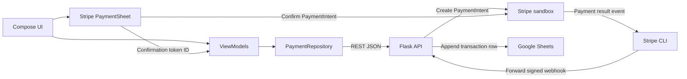

# PaymentApp

PaymentApp is a Kotlin Android app that accepts test card payments through Stripe PaymentSheet. It uses Jetpack Compose, MVVM, Retrofit, and Kotlin coroutines. A local Flask backend creates Stripe PaymentIntents, exposes payment status over REST, and writes the final payment result to Google Sheets after receiving a signed Stripe webhook.

The project runs in a Stripe sandbox. All payments in this README use Stripe test cards.

## Project structure

```text
ePayment/
├── android/                  Android Studio project
│   └── app/                  Compose screens, ViewModels, models, and repository
└── backend/
    ├── app.py                Flask REST routes and Stripe webhook handler
    ├── sheets_service.py     Google Sheets API client
    └── requirements.txt      Python dependencies
```

## Architecture



The Android app collects the customer name on **Card Setup** and the amount, currency, and note on **Payment**. The `PaymentViewModel` validates the amount and creates a checkout UUID when the card form opens. Stripe PaymentSheet collects the card details. The repository sends Flask the confirmation token ID and checkout details using a suspending Retrofit call.

Flask creates the PaymentIntent and returns its client secret to PaymentSheet. A successful creation response (`201`) means the intent exists. The payment result comes later, after Stripe processes the confirmation. Flask verifies the webhook signature and writes the result to Google Sheets. The Stripe event ID identifies deliveries that have already been recorded.

## Prerequisites

- Python 3.13, which was used for local testing, and `venv`.
- Android Studio with Android SDK 37 and an Android Emulator. The Android project uses the Gradle wrapper and declares its daemon JDK toolchain in `android/gradle/gradle-daemon-jvm.properties`.
- A Stripe sandbox with a test publishable key (`pk_test_…`) and test secret key (`sk_test_…`).
- Stripe CLI authenticated to the same sandbox.
- A Google Cloud project with the Google Sheets API enabled, a service account JSON credential, and a Google spreadsheet shared with the service account as an **Editor**.

## 1. Prepare Google Sheets and the local configuration

In your Google spreadsheet, create a tab named **Transactions**. Paste this tab-separated header row into cell **A1**.

```text
timestamp_utc	transaction_id	amount_minor	currency	note	payment_status	customer_identifier	error_message	stripe_event_id	checkout_id
```

Copy the spreadsheet ID from the URL. It is the part between `/d/` and `/edit`. Share the spreadsheet with the service account email and grant **Editor** access.

Create `backend/.env` with the following values. Fill in `STRIPE_WEBHOOK_SECRET` after starting the listener in Step 2.

```dotenv
STRIPE_SECRET_KEY='sk_test_REPLACE_ME'
STRIPE_WEBHOOK_SECRET='whsec_REPLACE_ME'
GOOGLE_APPLICATION_CREDENTIALS='/absolute/path/outside/project/service-account.json'
GOOGLE_SHEET_ID='REPLACE_WITH_SPREADSHEET_ID'
```

Keep the Stripe secret key, webhook signing secret, and Google service account JSON on the backend. Store the JSON outside the project directory and exclude `.env` and the credential file from Git and submission archives.

In `android/app/src/main/res/values/stripe_config.xml`, set `stripe_publishable_key` to the `pk_test_…` key from the same sandbox. Put the key between the opening and closing tags.

```xml
<?xml version="1.0" encoding="utf-8"?>
<resources>
    <string name="stripe_publishable_key" translatable="false">pk_test_REPLACE_ME</string>
</resources>
```

See the [Stripe API key documentation](https://docs.stripe.com/keys) and [Google service account documentation](https://developers.google.com/workspace/guides/create-credentials).

## 2. Start Stripe CLI in Terminal 1

On macOS with Homebrew, install Stripe CLI if needed, then sign in. When authorizing the CLI, select the sandbox used by the Android app and Flask.

```bash
brew install stripe
stripe login
```

Start the listener and leave this terminal open.

```bash
stripe listen \
  --events payment_intent.succeeded,payment_intent.payment_failed \
  --forward-to http://127.0.0.1:5050/stripe/webhook
```

When the CLI prints `Ready!`, copy its `whsec_…` signing secret into `STRIPE_WEBHOOK_SECRET` in `backend/.env`. The listener forwards Stripe's events to Flask on this Mac. [Stripe CLI listener documentation](https://docs.stripe.com/cli#listen)

## 3. Start Flask in Terminal 2

From the `ePayment` project root, run the following commands. Create the virtual environment and install dependencies on the first run.

```bash
cd backend
python3 -m venv .venv
source .venv/bin/activate
python -m pip install -r requirements.txt
python app.py
```

Leave Flask running. From another terminal, verify that it responds.

```bash
curl -i --max-time 5 http://127.0.0.1:5050/health
```

Expected result is HTTP `200` with:

```json
{"status":"ok"}
```

Flask loads `backend/.env` at startup. Restart `python app.py` after changing that file.

## 4. Run Android

1. Open the `android/` folder as a project in Android Studio and let Gradle Sync finish.
2. Select the `app` run configuration and your Android Emulator. Click **Run**.
3. On an **Android 17 (API 37)** emulator, grant local network access to the installed debug app. Run this on the Mac while one emulator is connected.

   ```bash
   "$HOME/Library/Android/sdk/platform-tools/adb" -e shell pm grant \
     com.example.paymentapp android.permission.ACCESS_LOCAL_NETWORK
   ```

   Repeat the grant after reinstalling the App if the permission has been reset. The debug app uses `http://10.0.2.2:5050/`, which reaches Flask on the Mac at `127.0.0.1:5050`. [Android Emulator networking](https://developer.android.com/studio/run/emulator-networking-address) · [Android local network permission](https://developer.android.com/privacy-and-security/local-network-permission)

## 5. Run a test payment

Keep **Flask** and **Stripe CLI** running.

1. On **Card Setup**, enter `Lucia Demo` and tap **Continue**.
2. On **Payment**, enter `25.00`, select **USD**, and enter a note such as `README success check`.
3. Tap **Continue to card**. If Stripe shows a list of payment methods, choose **Card**.
4. Enter `Alice Example` as the cardholder, expiry `12/34`, CVC `123`, and ZIP `02115` if requested. Use the card number for the outcome you want to test.
5. Tap **Pay** once.

| Scenario | Stripe test card | Expected result |
|---|---|---|
| Success | `4242 4242 4242 4242` | PaymentSheet closes, the App shows **Payment completed** and a `pi_` ID, and Stripe sends `payment_intent.succeeded`. |
| Decline | `4000 0000 0000 0002` | PaymentSheet shows a card decline, and Stripe sends `payment_intent.payment_failed`. |

The card number determines the result in the PaymentSheet flow. Use a fresh checkout and a distinct note such as `README decline check` for the second test. [Stripe test cards](https://docs.stripe.com/testing)

## 6. Verify the payment and the Google Sheets row

### Check the Stripe payment status

Copy the `pi_` ID displayed after a successful payment. For a declined attempt, find the PaymentIntent ID in the corresponding event details in Stripe Workbench or in the Google Sheets row.

Replace `pi_REPLACE_ME` with that ID.

```bash
PAYMENT_INTENT_ID='pi_REPLACE_ME'
curl -i "http://127.0.0.1:5050/payments/$PAYMENT_INTENT_ID"
```

Example response for a successful test payment:

```json
{
  "amount": 2500,
  "currency": "usd",
  "error_code": null,
  "payment_intent_id": "pi_REPLACE_ME",
  "status": "succeeded"
}
```

HTTP `200` means the lookup succeeded. Read `status` for the payment outcome. A declined test card normally leaves the PaymentIntent in `requires_payment_method` with `error_code` set to `card_declined`. Stripe represents amounts in minor units, so `2500` is `25.00` USD.

### Match the Google Sheets row

In the Stripe CLI terminal, look for the matching event and an HTTP `200` response from `POST /stripe/webhook`. Open **Transactions** and search column **B** for the same `pi_` ID.

| Column | What to verify |
|---|---|
| B | The PaymentIntent ID matches the App or Stripe. |
| C and D | The amount is `2500` and the currency is `usd` for the example. |
| E | The note matches the text entered on Payment. |
| F | The status is `succeeded` for success or `requires_payment_method` for the decline test. |
| G | The customer name is `Lucia Demo`, taken from Card Setup. |
| H | The decline row contains an error message. |
| I | The `evt_` ID matches the Stripe event. |
| J | The checkout UUID identifies the checkout started in the App. |

The App can show completion before the webhook finishes writing the row. Use the CLI's webhook response and the row in Sheets to verify logging.

## API summary

| Method and path | Purpose |
|---|---|
| `GET /health` | Returns `200` with `{"status":"ok"}`. |
| `POST /payments/intents` | Accepts `amount`, `currency`, `confirmation_token_id`, `customer_name`, `note`, and `checkout_id`. Returns `201` with the PaymentIntent ID, client secret, and initial Stripe status. |
| `GET /payments/<id>` | Retrieves the current Stripe status, amount, currency, and payment error code. Returns `404` for an unknown PaymentIntent. |
| `POST /stripe/webhook` | Verifies Stripe's signature and writes PaymentSheet success or failure events to Google Sheets. |
| `POST /payments/create` | Runs the original backend-only sandbox demo using `test_scenario` set to `success` or `decline`. |

## Additional checks

| Check | How to run it | Expected outcome |
|---|---|---|
| Invalid amount | Leave the amount empty or enter `0`, then tap **Continue to card**. | The App shows a validation message. |
| Flask offline | Stop Flask and try submitting a valid test card in PaymentSheet. | PaymentSheet shows a connection error. Restart Flask and check `/health` before the next attempt. |
| Flask configuration error | Stop Flask, then start it temporarily with `STRIPE_SECRET_KEY='' python app.py`. Submit from PaymentSheet. | Flask returns `500` and PaymentSheet shows the backend error. Stop the temporary process and restart normally with `python app.py`. |

## Troubleshooting

- **The Mac can reach `/health`, but the App times out.** Check the API 37 local network permission and verify that the App is using `10.0.2.2:5050`.
- **PaymentSheet spins and Logcat shows `UnknownHostException`.** Stop the emulator and use **Tools → Device Manager → Cold Boot**. This starts Android without restoring its saved Quick Boot snapshot. [Android Emulator cold boot](https://developer.android.com/studio/run/emulator-snapshots#cold-boot-once)
- **Webhook returns `400`.** Check that `backend/.env` contains the `whsec_…` value printed by the running `stripe listen` command and that Flask was restarted after the change.
- **Payment succeeded, but there is no new row.** Check for the matching Stripe event in the CLI and inspect the `/stripe/webhook` response. If it returns `502`, check `GOOGLE_SHEET_ID`, the `Transactions` tab name, the service account's Editor access, and the Flask log.
- **Gradle reports duplicate files with names ending in ` 2.class` or ` 2.xml` under `app/build`.** From `android/`, run `./gradlew :app:clean` and then run the App again.